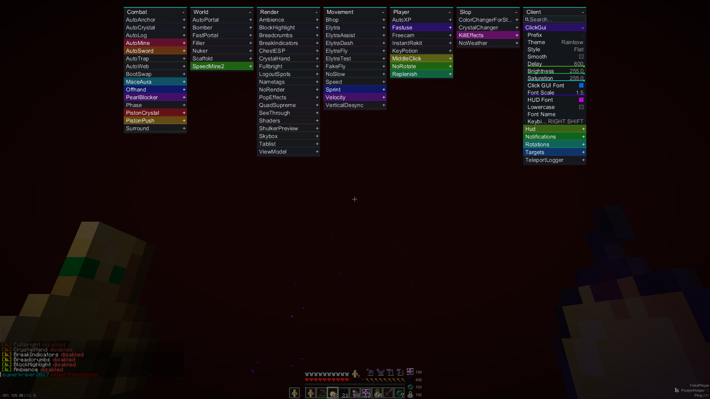

<div align="center">

# ketamine.club

**"Put dmt on 2b2t skidlist 👺👺👺👺"**
<div align="center">
  
  <br/>
  <sub><i>Allah</i></sub>
</div>
</div>

---

## Screenshots

<div align="center">
  
  <br/>
  <sub><i>Ugly ass</i></sub>
</div>

## Features

- **ClickGUI** — pixelated bullshit
- **Custom font renderer** — worst custom font renderer ever existed
- **PingBypass** — barely working bullshit bypass
- **Command system** — oyvey command system
- **Friends & Enemies** — oyvey friends & enemies system
- **Config save/load** — load bs and saves bs
- **90+ modules** — EVERY category you could want and several you couldnt

## Build

```bash
git clone https://github.com/yourname/ketamine.club
cd ketamine.club
./gradlew build
```

The jar lands in `build/libs/`. Requires **Java 25** and **Minecraft 26.2** with **Fabric Loader 0.19.5**.

## Usage

1. drop bs jar in le mods folder (optionally(not recommended))
2. launch the game (optionally)
3. press right shift oyvey default clickgui bind(dont do that)
4. turn on everything regeret everything

Available commands: `.toggle` · `.bind` · `.prefix` · `.friend` / `.enemy` · `.savekit` / `.loadkit` · `.fakeplayer` · `.activemods` · `.syncall` · `.funny` · `.help` <--- none of them needed

## Credits


*NO CODE IS ORIGINAL. ALL CODE IS STOLEN. HAPINESS IS STOLEN TOO.*


 **[oyvey-ported](https://github.com/mioclient/oyvey-ported)** <br/>
for the **base** this client is built on — thank you mioclient

 **[homovore-public](https://github.com/leonetics/homovore-public)** <br/>
for basically **all the modules** — thank you leonetics

 **gretten** <br/>
for **explaining pingbypass** — possibly the only true human contribution in this repo(LOL?)

 **chinese AIs** <br/>
for **doing this whole client** (LOL?)


<div align="center">

*Made with love and AI*

</div>
